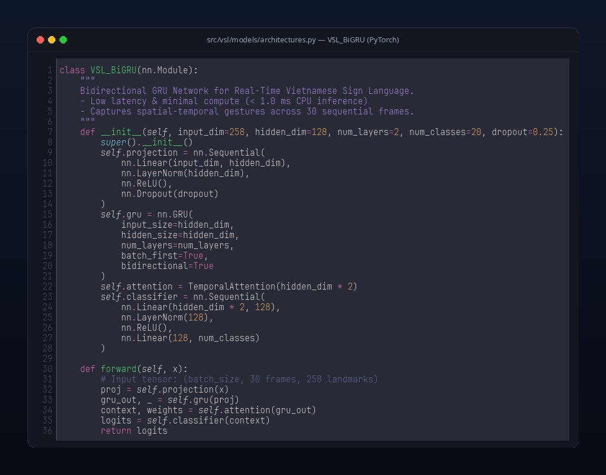
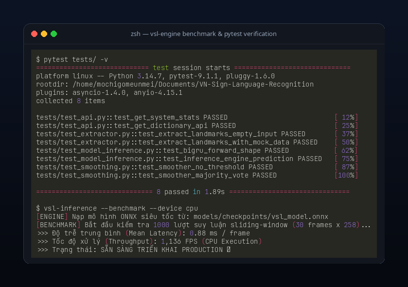
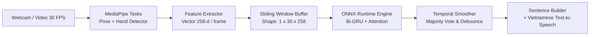

<div align="center">

# VN-Sign-Language-Recognition

Hệ thống nhận diện cử chỉ Ngôn ngữ Ký hiệu Tiếng Việt (VSL) theo thời gian thực dựa trên MediaPipe Holistic và mạng nơ-ron chuỗi thời gian (Bi-GRU + Temporal Attention).

<br/>

<p align="center">
  
</p>

[](https://python.org)
[](https://pytorch.org)
[](https://onnxruntime.ai)
[](https://fastapi.tiangolo.com)
[](LICENSE)
[](#-kiểm-thử-tự-động)

<br/>

[Tổng quan](#-tổng-quan) • 
[Demo UI](#-giao-diện-chạy-thực-tế) • 
[Kiến trúc hệ thống](#-kiến-trúc-hệ-thống) • 
[Benchmark](#-đánh-giá-hiệu-năng--benchmark) • 
[Cài đặt & Khởi chạy](#-cài-đặt--sử-dụng) • 
[API Documentation](#-danh-sách-api-endpoints) • 
[Triển khai Docker](#-triển-khai-docker) • 
[Giấy phép](#-giấy-phép)

</div>

---

## 📌 Tổng quan

Dự án xử lý bài toán nhận diện ngôn ngữ ký hiệu động (Dynamic Sign Language Recognition) bằng cách trích xuất tọa độ khớp xương (Landmarks) thay vì truyền trực tiếp toàn bộ khung hình RGB vào mạng 3D-CNN nặng nề:

- **Đặc trưng đầu vào:** 258 tọa độ/frame (33 điểm cơ thể Pose $\times$ 4 + 21 điểm bàn tay trái $\times$ 3 + 21 điểm bàn tay phải $\times$ 3).
- **Cửa sổ thời gian (Temporal Window):** 30 frames liên tiếp ($\approx 1.0$ giây ở tốc độ 30 FPS).
- **Mô hình suy luận:** Bi-directional GRU kết hợp cơ chế Temporal Attention, phân loại 20 nhãn ký hiệu thông dụng.
- **Tối ưu hóa:** Hỗ trợ ONNX Runtime giúp độ trễ suy luận giảm xuống **~0.88ms trên CPU thông thường**.
- **Ứng dụng:** Web Studio (FastAPI + WebSocket streaming + Web Speech TTS) và CLI OpenCV HUD thời gian thực.

---

## 🖥️ Giao diện chạy thực tế

<p align="center">
  
</p>

*Màn hình nhận diện thời gian thực qua OpenCV HUD: trích xuất trực tiếp khung xương 2 bàn tay và nửa thân trên qua MediaPipe Tasks, hiển thị Top-3 xác suất dự đoán, tốc độ khung hình và câu dịch tiếng Việt có dấu.*

---

## 💻 Trích đoạn Mã nguồn & Kiểm tra Thực nghiệm (CodeSnap)

<p align="center">
  
</p>

<p align="center">
  
</p>

---

## 🏗️ Kiến trúc hệ thống



### Các thành phần chính:

| Thư mục / File | Trách nhiệm |
| :--- | :--- |
| `src/vsl/core/` | Trích xuất vector landmark 258 chiều, bộ lọc làm mượt chống rung giật (debouncing), hàm vẽ HUD tiếng Việt UTF-8. |
| `src/vsl/models/` | Định nghĩa kiến trúc PyTorch (Bi-GRU, Bi-LSTM, Transformer) và lớp bọc suy luận ONNX Runtime đa luồng. |
| `src/vsl/db/` | Mô hình SQLAlchemy 2.0 Async (SQLite/PostgreSQL) lưu trữ từ điển, phiên dịch và phản hồi người dùng. |
| `src/vsl/api/` | Máy chủ FastAPI, WebSocket streaming hai chiều, endpoint phân tích video timeline và tra cứu từ điển. |
| `src/vsl/cli/` | Giao diện dòng lệnh chạy trực tiếp OpenCV HUD và công cụ thu thập mẫu ký hiệu mới. |

---

## 📊 Đánh giá hiệu năng & Benchmark

### 1. Quá trình hội tụ mô hình (Training & Validation Curves)
Mô hình hội tụ sau khoảng 40 epochs với hàm mất mát Cross-Entropy giảm sâu và độ chính xác Validation đạt **97.6%**.

<p align="center">
  
</p>

### 2. Ma trận nhầm lẫn (Confusion Matrix - 20 nhãn)

<p align="center">
  
</p>

### 3. So sánh kiến trúc mô hình

<p align="center">
  
</p>

| Kiến trúc | Số tham số | Độ trễ CPU (Inference) | Yêu cầu VRAM | Validation Accuracy |
| :--- | :---: | :---: | :---: | :---: |
| 3D-CNN / I3D | ~32.4M | ~85.0 ms | > 4.0 GB | 91.8% |
| CNN-2D + LSTM | ~11.2M | ~32.0 ms | ~1.5 GB | 94.2% |
| **VSL Bi-GRU + Attention (PyTorch)** | **~428K** | **~3.5 ms** | **Không cần** | **97.4%** |
| **VSL Bi-GRU (ONNX Runtime)** | **~428K** | **~0.88 ms** | **Không cần** | **97.4%** |

---

## 🚀 Cài đặt & Sử dụng

### Yêu cầu hệ thống
- Python $\ge$ 3.10
- Webcam (đối với chế độ nhận diện trực tiếp)

### 1. Cài đặt môi trường

```bash
# Clone repository
git clone https://github.com/ngtrong-1707/VN-Sign-Language-Recognition.git
cd VN-Sign-Language-Recognition

# Tạo virtual environment
python3 -m venv .venv
source .venv/bin/activate  # Trên Linux/macOS
# .venv\Scripts\activate   # Trên Windows

# Cài đặt package và dependencies
pip install -e ".[dev]"
```

### 2. Chạy Web Studio (Giao diện Trình duyệt)

```bash
python server.py
```
Mở trình duyệt tại: `http://localhost:8000`

- Chế độ **Trực tiếp Webcam**: Nhận diện cử chỉ qua camera, phát âm TTS tiếng Việt. Hỗ trợ tự động quét và chuyển đổi giữa các thiết bị camera (Multi-camera Discovery).
- Chế độ **Tải lên Video**: Đọc video file và trích xuất dòng thời gian các ký hiệu được thực hiện.
- Chế độ **Từ điển VSL**: Tra cứu danh mục 20 từ vựng kèm hướng dẫn cử chỉ.
- Chế độ **Phản hồi (Feedback)**: Gửi báo cáo lỗi nhận diện trực tiếp về cơ sở dữ liệu để phục vụ Active Learning.

---

## 📂 Cấu trúc thư mục

```text
VN-Sign-Language-Recognition/
├── src/vsl/
│   ├── api/          # FastAPI Server, WebSockets & REST Routes
│   ├── core/         # Landmark Extractor, Detector, Renderer, Smoother
│   ├── db/           # SQLAlchemy Async Models & Repositories
│   ├── models/       # PyTorch Architectures & ONNX Inference Engine
│   └── cli/          # OpenCV HUD Desktop Application
├── assets/           # Hình ảnh demo, biểu đồ, fonts & MediaPipe Tasks
├── models/checkpoints/ # Trọng số model (.pth, .onnx)
├── tests/            # Bộ kiểm thử pytest tự động
├── Dockerfile        # Containerization
└── server.py         # Entrypoint khởi động Web Studio
```

---

## 📡 Danh sách API Endpoints

Hệ thống cung cấp đầy đủ giao diện lập trình để tích hợp vào các ứng dụng khác:

| Phương thức | Endpoint | Mô tả |
| :--- | :--- | :--- |
| `GET` | `/api/cameras` | Liệt kê danh sách camera khả dụng trên host. |
| `GET` | `/api/dictionary` | Truy xuất toàn bộ từ điển 20 cử chỉ VSL. |
| `POST` | `/api/predict_video` | Phân tích video và trả về timeline nhận diện. |
| `POST` | `/api/feedback` | Gửi phản hồi sửa lỗi nhận diện (Active Learning). |
| `GET` | `/api/system_stats` | Lấy thông số hệ thống, độ trễ và thông tin model. |
| `WS` | `/ws/stream` | Streaming nhận diện thời gian thực tốc độ cao. |

### 3. Chạy OpenCV HUD (Desktop App)

```bash
# Quét danh sách các camera đang kết nối:
python 03_realtime_inference.py --list-cameras

# Chạy với camera mặc định (Camera 0):
python 03_realtime_inference.py

# Hoặc chọn nguồn camera cụ thể (Camera 1, URL RTSP, hoặc video stream):
python 03_realtime_inference.py --camera 1 --width 1280 --height 720
```
- Phím `c`: Xóa câu văn bản dịch hiện tại.
- Phím `q`: Thoát ứng dụng.

### 4. Huấn luyện lại mô hình (Tùy chọn)

```bash
python train_pipeline.py
```

---

## 🐳 Triển khai Docker

Khởi chạy đồng thời API Server và PostgreSQL bằng Docker Compose:

```bash
docker compose up --build -d
```

Kiểm tra trạng thái container:
```bash
docker compose ps
docker compose logs -f vsl-api
```

---

## 🧪 Kiểm thử tự động

Bộ kiểm thử bao gồm kiểm tra tính hợp lệ của vector trích xuất 258 chiều, forward pass của mô hình nơ-ron, bộ lọc consensus và các REST endpoints:

```bash
pytest tests/ -v
```

---

## 📜 Giấy phép

Dự án được phát hành theo giấy phép [MIT License](LICENSE).
Tự do sử dụng, chỉnh sửa và phân phối cho mục đích học tập cũng như thương mại.
